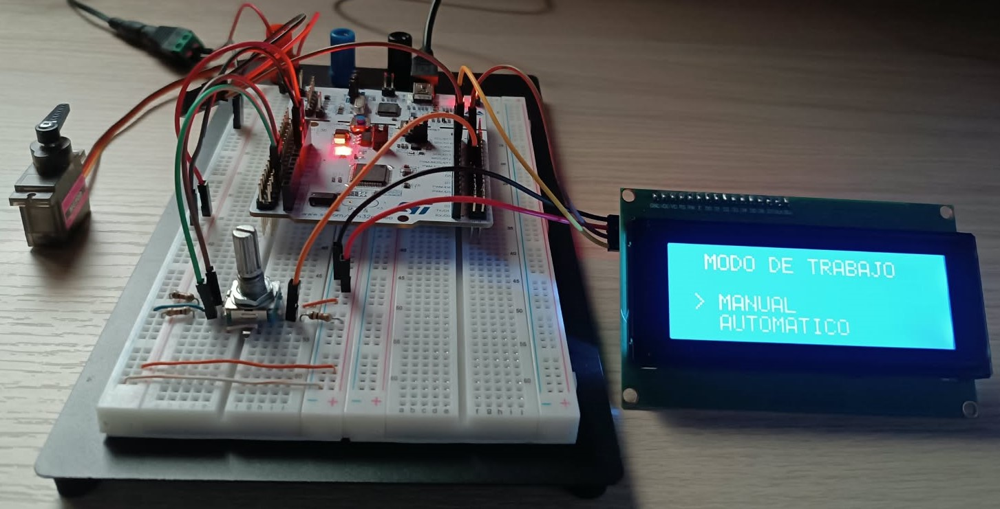
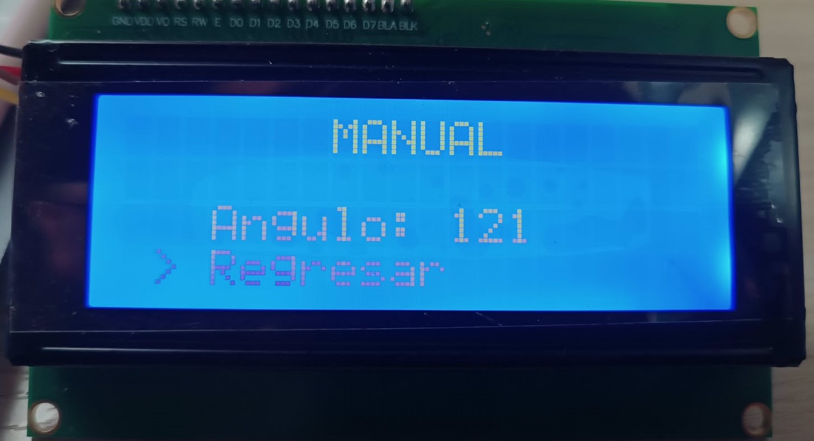
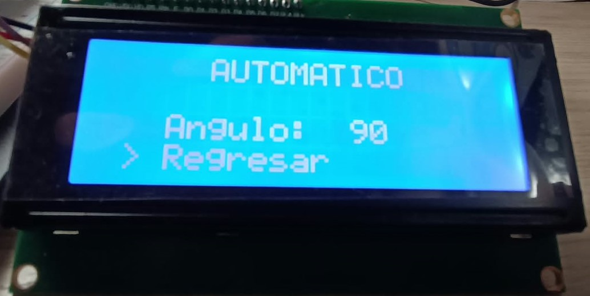

# Control de posición de un servomotor mediante LCD, encoder y UART

## 1. Descripción del proyecto

Proyecto de sistemas embebidos desarrollado con la tarjeta **STM32 NUCLEO-F446RE**, que permite controlar la posición angular de un servomotor mediante dos modos de operación: manual y automático.

El sistema dispone de una interfaz de usuario basada en una pantalla LCD y un encoder rotativo para navegar por el menú y ajustar la posición del servomotor. También incorpora comunicación UART para recibir comandos desde un dispositivo externo en modo automático.

La pantalla LCD muestra el ángulo de posición en ambos modos de operación.

## 2. Funcionalidades

* **Menú de selección:** permite navegar entre los modos manual y automático mediante el encoder.
* **Selección y navegación:** el pulsador del encoder permite confirmar la opción seleccionada y regresar al menú principal desde los modos de operación.
* **Modo manual:** el encoder permite incrementar o disminuir el ángulo de posición del servomotor.
* **Modo automático:** el sistema recibe comandos mediante UART para establecer el ángulo de posición del servomotor.
* **Visualización de posición:** la pantalla LCD muestra el ángulo de referencia en ambos modos.
* **Control PWM:** generación de la señal PWM para posicionar el servomotor.
* **Arquitectura modular:** separación del firmware en drivers y módulos de aplicación.

## 3. Hardware utilizado

| Componente | Función |
|---|---|
| STM32 NUCLEO-F446RE | Unidad de procesamiento |
| Encoder rotativo EC11 | Navegación y ajuste angular |
| LCD 20x4 con interfaz I2C | Menú y visualización |
| Servomotor MG90D | Actuador de posición |
| UART | Comunicación con un dispositivo externo |



## Diagrama de Conexiones (STM32 Nucleo-F446RE)

La siguiente tabla detalla la distribución de pines y las conexiones requeridas para todos los periféricos del sistema:

| Periférico | Pin Componente | Pin Nucleo-F446RE | Función / Configuración | Notas |
| :--- | :--- | :--- | :--- | :--- |
| **UART (Consola/FTDI)** | TX <br> RX <br> GND | **PA3** (RX) <br> **PA2** (TX) <br> **GND** | `USART2_RX` <br> `USART2_TX` <br> Tierra | Comunicación mediante cable USB de programación.|
| **Pantalla LCD (I2C)** | SCL <br> SDA <br> VCC <br> GND | **PB8** <br> **PB9** <br> **3.3V** <br> **GND** | `I2C1_SCL` <br> `I2C1_SDA` <br> Alimentación <br> Tierra | Conexión mediante módulo adaptador I2C (PCF8574), no requiere resistencias de Pull-up externas. |
| **Encoder Rotativo** | CLK <br> DT <br> SW <br> GND | **PA0** <br> **PA1** <br> **PA8** <br> **GND** | `TIM5_CH1` (Encoder Mode) <br> `TIM5_CH2` (Encoder Mode) <br> `GPIO_Input` (Pulsador) <br> Tierra | **Requiere Pull-up externa** (10kΩ a 3.3V) en CLK.<br>**Requiere Pull-up externa** (10kΩ a 3.3V) en DT.<br>**Requiere Pull-up externa** (10kΩ a 3.3V) en SW. |
| **Servomotor** | PWM (Naranja) <br> VCC (Rojo) <br> GND (Marrón) | **PA6** <br> **+5V (Fuente Ext.)** <br> **GND (Fuente Ext.)** | `TIM3_CH1` (PWM Generation) <br> Alimentación Externa <br> Tierra Externa | **¡Atención!** No alimentar el servo desde la Nucleo.<br>Consumo típico elevado para el regulador de la placa. |
| **Pulsador** | OUT <br> GND | **PA8** <br> **GND** | `GPIO_Input` <br> Tierra | **Requiere Pull-up externa** (10kΩ a 3.3V). |
| **Acople de Tierras** | GND (Fuente Ext.) | **GND** | **Masa Común** | **Obligatorio** unir el GND de la fuente externa con el GND de la Nucleo. |

## 4. Arquitectura del software

El firmware se organiza en módulos independientes para separar la lógica de aplicación del control de los periféricos.

- **System:** gestión de los estados en la MEF principal y modos de operación.
- **Encoder:** lectura del encoder y detección de cambios de posición.
- **LCD:** inicialización, posicionamiento del cursor y escritura de caracteres.
- **Servomotor:** conversión de la referencia angular a una señal PWM.
- **UART:** recepción y procesamiento de comandos seriales.

### Organización del proyecto

**[COMPLETAR: ajustar el árbol de directorios para que coincida con el repositorio real.]**

```text
📂 Trabajo_Practico
 ├── 📂 Core
 │    ├── 📂 Inc
 │    │    └── main.h    <-- Definiciones globales y prototipos del sistema.
 │    │    └── system.h  <-- Variables y funciones públicas de la MEF principal.      
 │    └── 📂 Src
 │         └── main.c    <-- Punto de entrada principal y bucle de control.
 │         └── system.c  <-- Implementación de la MEF principal. 
 └── 📂 Drivers
      ├── 📂 Button      <-- Control para desplazamiento en el menú.
      ├── 📂 CMDParser   <-- Gestión de Consola y Comandos.
      ├── 📂 Encoder     <-- Gestión de los pulsos mediante timer.
      ├── 📂 LCD         <-- Control de Pantalla por I2C.
      └── 📂 Servomotor  <-- Generación PWM de Movimiento.     
```

**Nota sobre la anatomía interna de cada Driver:** 
Cada una de las carpetas listadas arriba (`Driver_XXXX/`) contiene internamente su propio esquema modular:
- `📂 inc/` → `api.h` (Prototipos globales) y `api_port.h` (Prototipos de bajo nivel).
- `📂 src/` → `api.c` (Implementación lógica) y `api_port.c` (Enlace directo a STM32 HAL).

## 5. Modos de operación

### 5.1. Modo manual

1. El usuario selecciona `MANUAL` desde el menú LCD presionando el pulsador del encoder.
2. El encoder permite incrementar o disminuir el ángulo de referencia.
3. El sistema actualiza la señal PWM del servomotor.
4. La pantalla LCD muestra el ángulo seleccionado.
5. Presione el pulsador para regresar al menú principal.



### 5.2. Modo automático

1. El usuario selecciona `AUTOMATICO` desde el menú LCD presionando el pulsador del encoder.
2. El sistema habilita la recepción de comandos mediante UART.
3. El comando recibido se valida y procesa.
4. El sistema actualiza la posición de referencia del servomotor.
5. La pantalla LCD muestra el ángulo solicitado.
6. Presione el pulsador para regresar al menú principal.



## 6. Parámetros de configuración

Los parámetros principales del sistema se encuentran en los archivos de configuración de los drivers (xxxx_port.h y xxxx.h).

| Módulo | Parámetros principales |
|---|---|
| Encoder | Temporizador, carácteristicas del encoder, posición inicial y límites angulares |
| LCD | Dirección I2C, dimensiones y configuración de la interfaz |
| Servomotor | Temporizador, frecuencia PWM, pulsos mínimo y máximo, posición inicial |
| UART | Velocidad de transmisión, bits de datos, paridad y bits de parada |
| Sistema | Modo inicial, estados disponibles y comportamiento de navegación |

## 7. Protocolo de comunicación UART

- Comandos disponibles.

```text
help\r\n
```

- Posicionar el servomotor a 40°.

```text
SERVO,40\r\n
```

- Velocidad de transmisión: 115200.
- Formato: 8N1 (8 bits, sin paridad y 1 bit de parada).
- Terminación del comando: [CR, LF o CR+LF].
- Rango angular permitido: 0° a 180°.
- Respuesta del sistema: Sin respuesta.
- Tratamiento de comandos inválidos: Mensaje de error.

## 8. Herramientas y tecnologías

- Lenguaje C/C++ para sistemas embebidos.
- STM32F446RE.
- STM32CubeIDE.
- Temporizadores para el encoder y la generación PWM.
- Comunicación I2C con la pantalla LCD.
- Comunicación UART con un dispositivo externo.
- Máquinas de estados finitos (MEF).

## 9. Compilación y ejecución

1. Clonar el repositorio.
2. Abrir el proyecto en STM32CubeIDE.
3. Verificar la configuración de los periféricos y las conexiones.
4. Compilar el firmware.
5. Programar la tarjeta NUCLEO-F446RE.
6. Configurar el terminal serial con los parámetros UART documentados.
7. Seleccionar el modo de operación desde la pantalla LCD.

## 10. Autor

Ing. Carlos Andrés Restrepo Restrepo.

Proyecto desarrollado para la materia de Programación de Microprocesadores.


